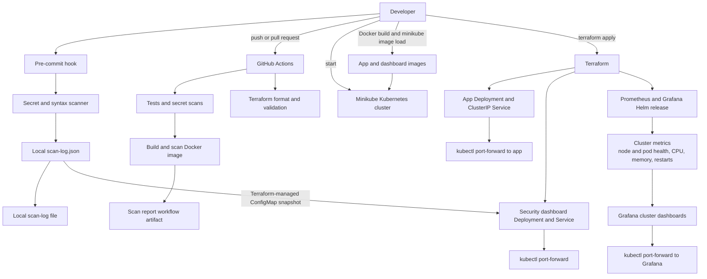

# GitHook Shield

GitHook Shield stops hardcoded secrets and broken code before they reach a Git repository, then checks them again in CI. It packages a small Flask app with Docker and runs it on a local Minikube Kubernetes cluster managed by Terraform. Prometheus and Grafana provide cluster-level monitoring.

The project uses open-source, local infrastructure and does not require AWS or LocalStack.

## What it does

- **Blocks secrets at commit time.** A pre-commit hook runs a custom scanner on staged changes. It catches known token formats (AWS, GitHub, Slack, Stripe, Google, private keys) and high-entropy values assigned to credential-like names such as `password` or `api_key`.
- **Blocks broken code at commit time.** Staged `.py`, `.json`, and `.sh` files must pass a syntax check.
- **Re-checks everything in CI.** GitHub Actions runs the tests, scans every tracked file with the same scanner, scans the full Git history with TruffleHog, validates Terraform, builds the Docker image, and scans it with Trivy.
- **Builds and scans the app image.** GitHub Actions builds the Docker image and archives vulnerability reports as workflow artifacts.
- **Deploys and monitors locally.** Terraform manages the Kubernetes app and security dashboard, and installs Prometheus and Grafana for cluster metrics.
- **Shows scan activity.** A dashboard runs in Kubernetes and polls its scan-log snapshot every five seconds. Run Terraform apply to copy new local scan results into the cluster.
- **Measures itself.** A labeled dataset compares the scanner with Gitleaks and detect-secrets.

## Architecture



CI checks Terraform configuration but does not apply it: the GitHub-hosted runner does not have access to the developer's Minikube cluster. Deployment and monitoring are applied locally after building the image into Minikube.

## Project structure

```
.github/workflows/ci.yml     CI pipeline
app/                         Flask service, Dockerfile, requirements
dashboard/                   Kubernetes-hosted security activity dashboard
evaluation/                  labeled dataset, evaluation script, results
hooks/pre-commit             commit-time hook
scanner/secretscan.py        custom secret scanner and syntax checks
scripts/                     install, demo, and live sample scripts
terraform/                   Kubernetes app/dashboard and Prometheus/Grafana resources
tests/                       unit tests for the scanner and the app
```

## Quick start

For the local Kubernetes deployment, install Git, Python 3.12 or newer, Docker, Minikube, kubectl, and Terraform 1.9.8 or newer. Terraform's Helm provider installs the monitoring chart; the Helm CLI is optional. The scanner and unit tests can be used without Minikube or Terraform. No AWS account, AWS credentials, or LocalStack installation is needed.

```
pip install -r app/requirements.txt
bash scripts/install-hooks.sh
python3 -m unittest discover -s tests -v
```

The unit tests should end with `OK`. The hook is now active for this repository.

## Components

### Secret scanner (`scanner/secretscan.py`)

- **Token rules:** fixed patterns for AWS access key IDs (`AKIA`, `ASIA`), GitHub tokens (`gh[pousr]_`), Slack tokens (`xox`), Stripe live keys (`sk_live_`), Google API keys (`AIza`), and PEM private key headers.
- **Assignment rule:** flags a quoted value of 8 or more characters assigned to a credential-like name, when the value has a Shannon entropy of at least 3.0 bits per character.
- **Allowlist:** placeholders such as `changeme`, `your_api_key_here`, and `<...>`, plus the AWS documentation example keys, are ignored.
- **Syntax checks:** `.py` files must parse, `.json` files must load, and `.sh` files must pass `bash -n`.
- **Output:** findings show the file, line, and rule, with the secret masked. The exit code is 1 when anything is found.

Run it on files directly, or on staged changes:

```
python3 scanner/secretscan.py path/to/file.py
python3 scanner/secretscan.py --staged --log scan-log.json
```

### Pre-commit hook (`hooks/pre-commit`)

Runs the scanner on staged changes and appends results to `scan-log.json`. Install it once per clone with `bash scripts/install-hooks.sh`.

Bypassing the hook with `git commit --no-verify` skips it entirely. CI catches what gets through.

### CI pipeline (`.github/workflows/ci.yml`)

Runs on pushes and pull requests to `main`.

| Job | What it does |
|---|---|
| `test` | Runs the unit tests and a compile check |
| `secret-scan` | Runs the custom scanner on every tracked file and TruffleHog on the full history |
| `terraform` | Checks formatting, initializes providers, and validates the Kubernetes configuration; it does not connect to or apply changes to Minikube |
| `build-and-scan` | Builds the Docker image, scans it with Trivy (fails on fixable HIGH and CRITICAL findings), and archives the report as a workflow artifact |

GitHub Actions runs CI checks only. Apply Terraform locally to deploy to your Minikube cluster.

### Application (`app/`)

A small Flask service with `/` and `/health` endpoints. The Dockerfile runs it as a non-root user on `python:3.12-slim`.

```
python3 app/app.py
curl http://localhost:5000/health
```

### Kubernetes deployment and monitoring (`terraform/`)

Terraform uses the current Minikube kubeconfig context to create the application namespace, Flask Deployment and Service, security dashboard Deployment and Service, dashboard data ConfigMap, and Prometheus/Grafana Helm release. Alertmanager is disabled. Prometheus scrapes available Kubernetes and node metrics; Grafana provides dashboards for cluster and pod behavior. The Flask app itself is not instrumented with application-specific Prometheus metrics.

Start Minikube with enough resources for the monitoring chart. Build the images with Docker and load them into Minikube:

```
minikube start --cpus=4 --memory=6144
docker pull nginx:1.27-alpine
docker build -t githook-shield:dev ./app
minikube image load githook-shield:dev
docker build -f dashboard/Dockerfile -t githook-shield-dashboard:dev-live-config .
minikube image load githook-shield-dashboard:dev-live-config
```

Initialize Terraform once, then plan and apply the Kubernetes resources:

```
terraform -chdir=terraform init
terraform -chdir=terraform validate
terraform -chdir=terraform plan
terraform -chdir=terraform apply
```

Run each port-forward in a separate terminal and keep those terminals open:

```
kubectl port-forward -n githook-shield svc/githook-shield 5000:80
kubectl port-forward -n githook-shield svc/githook-shield-dashboard 8000:80
kubectl port-forward -n monitoring svc/githook-shield-grafana 3000:80
```

Open the Flask health check at `http://localhost:5000/health`, the security activity dashboard at `http://localhost:8000/` (or `/dashboard/`), and Grafana at `http://localhost:3000`. The dashboard and Grafana are separate interfaces: the custom dashboard displays scanner results, while Grafana displays cluster metrics.

The security dashboard reads its scan log and evaluation results from a Kubernetes ConfigMap. Terraform copies the local `scan-log.json` and `evaluation/results.json` into the ConfigMap when apply runs. The projected files update in place without restarting the dashboard pod; allow a short time for Kubernetes to propagate an update. The page polls the data every five seconds.

Grafana's admin password is stored in a Kubernetes Secret; retrieve it with:

```
kubectl get secret -n monitoring githook-shield-grafana \
  -o jsonpath='{.data.admin-password}' | base64 --decode
```

Use the Grafana username `admin`. The Prometheus service is also available locally with:

```
kubectl port-forward -n monitoring svc/githook-shield-kube-promet-prometheus 9090:9090
```

Open `http://localhost:9090` to inspect Prometheus directly. Prometheus and Grafana use node-exporter and kube-state-metrics for cluster and pod dashboards; the separate Minikube metrics-server addon is not required. Terraform manages the app, dashboard, and monitoring release; do not also apply `deployment.yaml` for the same app. Run `terraform -chdir=terraform destroy` to remove Terraform-managed resources from Minikube.

### Security dashboard (`dashboard/`)

A single page served by the Kubernetes dashboard Deployment. It shows scan activity, KPI tiles, rule breakdown, and a comparison table. It refreshes the mounted log every five seconds and falls back to sample activity when there is no log. Changes written to local `scan-log.json` are copied to Kubernetes when you run `terraform -chdir=terraform apply`; the ConfigMap volume updates without restarting the dashboard pod.

```
kubectl port-forward -n githook-shield svc/githook-shield-dashboard 8000:80
```

Open `http://localhost:8000/` (or `http://localhost:8000/dashboard/`). To refresh the deployed dashboard data after generating new local scan events, run `terraform -chdir=terraform apply` again. Reapplying does not normally interrupt the dashboard connection because the pod is not restarted for ConfigMap-only changes.

### Evaluation (`evaluation/`)

`make_dataset.py` generates 30 files with one synthetic secret each, and 30 clean files with look-alike strings. The data uses a fixed seed and is gitignored, because it contains fake secrets.

`run_eval.py` runs our scanner, Gitleaks, and detect-secrets on the dataset and writes `results.md` and `results.json`.

```
python3 evaluation/make_dataset.py
python3 evaluation/run_eval.py
```

Gitleaks needs its binary on the PATH, and detect-secrets needs `pip install detect-secrets`. Tools that aren't installed are skipped.

### Demo (`scripts/demo.sh`)

Runs in a temporary repository, so your project is untouched. It shows a clean commit accepted, a hardcoded password blocked, a syntax error blocked, and a `--no-verify` bypass that goes through.

```
sh scripts/demo.sh
```

## Results

Evaluation on the labeled dataset (30 secret files, 30 clean files):

| Tool | Precision | Recall | F1 | False positives |
|---|---|---|---|---|
| GitHook Shield (ours) | 1.00 | 0.77 | 0.87 | 0 |
| Gitleaks | 1.00 | 0.80 | 0.89 | 0 |
| detect-secrets | 0.61 | 0.93 | 0.74 | 18 |

- Our scanner misses npm, Mailgun, and Twilio formats, which we didn't implement, and short passwords that fall below the entropy threshold.
- Gitleaks misses the PEM header case that our scanner catches.
- The dataset is small. Treat these numbers as indicative, not conclusive.

Scan times on the dataset are about 0.003 seconds for our scanner, about 1.4 seconds for Gitleaks, and about 1.6 seconds for detect-secrets.

## Known limitations

- `git commit --no-verify` skips the local hook. CI is the second line of defense.
- Pattern-based detection misses secrets in formats it doesn't know, and unusual names.
- A short password below the entropy threshold passes. The demo shows this, and the threshold is deliberately unchanged to avoid more false positives.
- The TruffleHog action is pinned to `@main`, not a release tag, so an upstream change could break the step.
- Cluster metrics cover Kubernetes and node behavior; the Flask app does not currently expose application metrics such as request rate or latency.
- Prometheus and Grafana consume additional local CPU, memory, and disk. Start Minikube with sufficient resources for the monitoring chart.

## Running the tests

```
python3 -m unittest discover -s tests -v
```

The scanner tests cover secret detection, false positives, syntax checks, and staged-mode behavior. The app tests cover `/` and `/health`.

